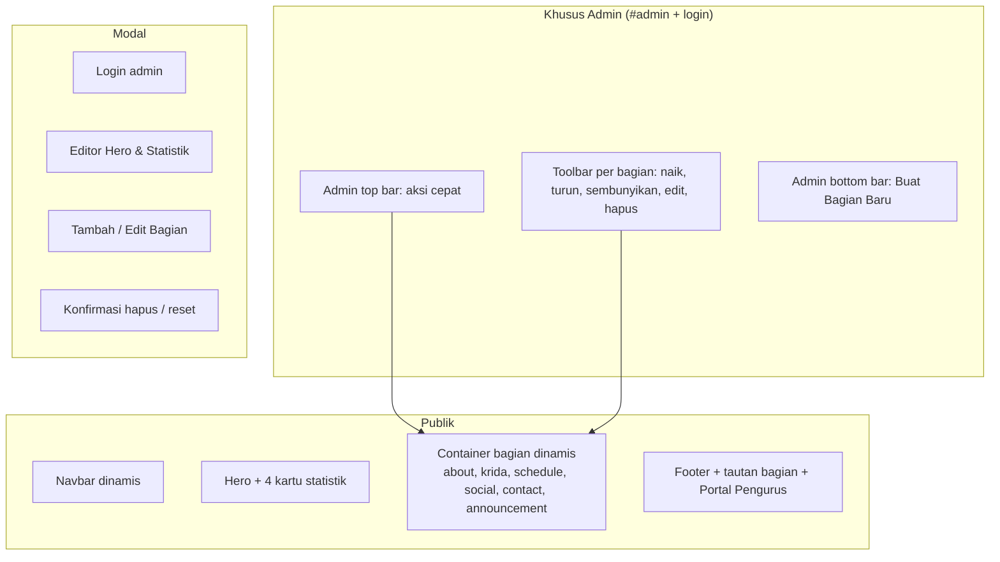
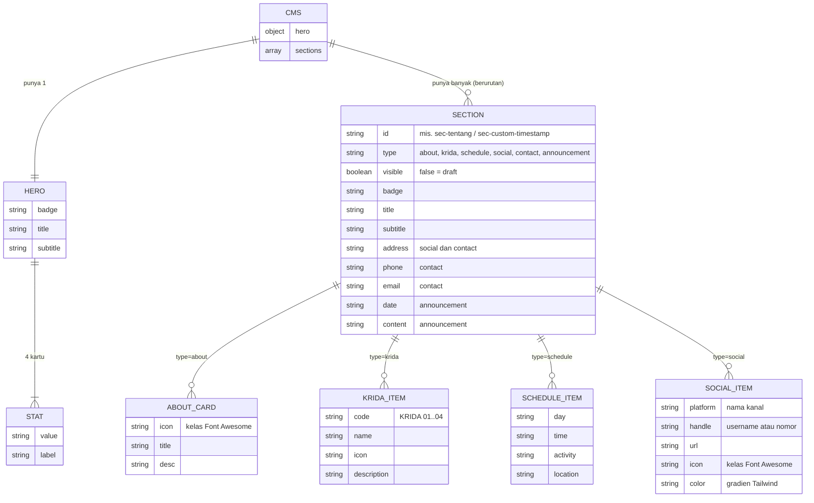
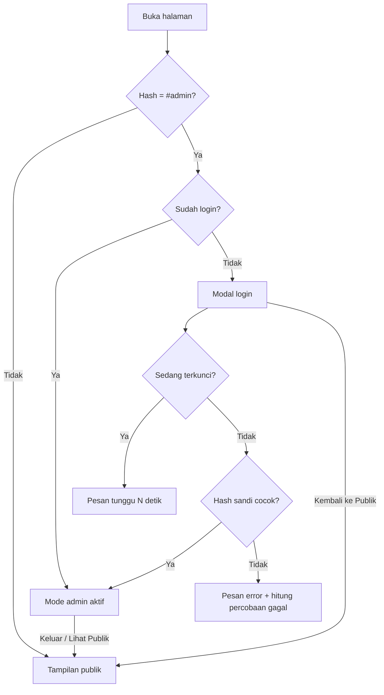
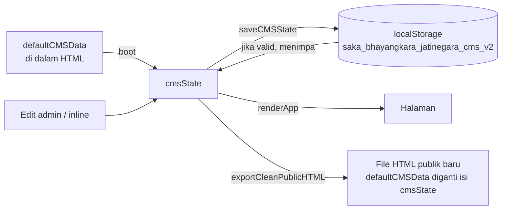
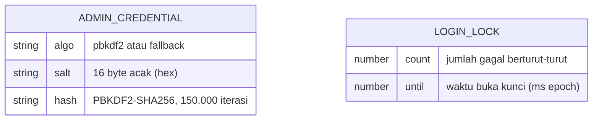
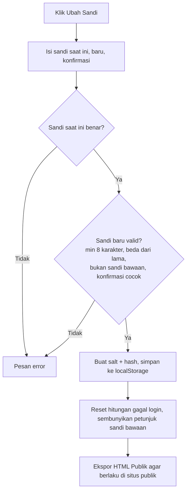

# Dokumentasi Portal Saka Bhayangkara Jatinegara (CMS Admin)

Dokumen ini dibuat dari file `saka_bhayangkara_jatinegara_portal_admin_cms.html` (versi dengan fitur **Ubah Sandi Admin**).

## 1. Ringkasan

Portal satu halaman (single-file HTML) untuk Satuan Karya Pramuka Bhayangkara Ranting Jatinegara. Halaman publik dan panel admin berada dalam satu file. Panel admin dibuka lewat `#admin`, tanpa backend. Semua data disimpan di browser (`localStorage`) dan dapat diekspor menjadi HTML publik.

| Aspek | Detail |
|---|---|
| Bahasa | HTML, JavaScript vanilla, Tailwind CSS (CDN) |
| Ikon / Font | Font Awesome 6.5.1, Google Fonts (Inter, Plus Jakarta Sans) |
| Penyimpanan | `localStorage` key `saka_bhayangkara_jatinegara_cms_v2` |
| Sesi admin | `sessionStorage` key `saka_bhayangkara_admin_auth` |
| Sandi admin | `localStorage` key `saka_bhayangkara_admin_cred_v1` (hash, bukan teks asli) |
| Batas login | `localStorage` key `saka_bhayangkara_admin_lock_v1` |
| Akses admin | URL `#admin` + sandi (bawaan: `bhayangkara2026`, wajib diganti) |
| Ekspor | Unduh HTML publik bersih (data tertanam di `defaultCMSData`) |
| Ukuran | Sekitar 1.700 baris, sekitar 100 KB |

---

## 2. Struktur Halaman



| Blok | ID / Elemen | Keterangan |
|---|---|---|
| Admin top bar | `#admin-workspace-bar` | Tombol: Edit Hero & Statistik, Tambah Bagian, toggle Edit Teks Langsung, Ekspor HTML Publik, **Ubah Sandi**, Reset, Keluar |
| Navbar | `#main-navbar`, `#dynamic-nav-links`, `#mobile-nav-drawer` | Menu dibuat otomatis dari bagian yang tampil (judul dipotong 22 karakter + `...`) |
| Hero | `#hero-badge`, `#hero-title`, `#hero-subtitle`, `#hero-stats-grid` | Teks hero dan 4 kartu statistik |
| Konten | `#cms-sections-container` | Semua bagian dirender dari `cmsState.sections` |
| Admin bottom bar | `#admin-bottom-bar` | Tombol "+ Buat Bagian Baru" |
| Footer | `#footer-nav-links` | Tautan bagian otomatis; info markas dan teks hak cipta bersifat statis |
| Toast | `#toast-container` | Notifikasi sukses, error, atau info |

---

## 3. Model Data (ERD Logis)

Seluruh data berada dalam satu objek `cmsState`.



### 3.1 Jenis bagian (`section.type`)

| Type | Field khusus | Dapat dibuat baru? | Cara edit |
|---|---|---|---|
| `about` | `cards[]` (icon, title, desc) | Tidak (bawaan) | Modal edit atau inline |
| `krida` | `items[]` (code, name, icon, description) | Tidak (bawaan) | Modal edit atau inline |
| `schedule` | `schedules[]` (day, time, activity, location) | Ya | Modal edit atau inline |
| `social` | `socials[]`, `address` | Ya | Modal edit atau inline |
| `contact` | `phone`, `email`, `address` | Ya | Modal edit atau inline |
| `announcement` | `date`, `content` | Ya | Modal edit atau inline |

### 3.2 Data bawaan (`defaultCMSData`)

| Bagian | `id` | Isi bawaan |
|---|---|---|
| Hero | – | Badge "Pangkalan Polsek Jatinegara • Polres Metro Jakarta Timur"; 4 statistik: 4 Krida, Polsek, Penegak, 24/7 |
| Tentang | `sec-tentang` | 3 kartu: Visi & Misi, Struktur & Pangkalan, Bakti & Pengabdian |
| Krida | `sec-krida` | Tibmas, Lantas, PPB, TPTKP |
| Jadwal | `sec-jadwal` | Sabtu 13.00–17.00 (Latihan Rutin); Minggu tentatif 07.00–11.00 (Bakti Masyarakat) |
| Media sosial | `sec-medsos` | Instagram, WhatsApp, YouTube + alamat sanggar |
| Kontak | `sec-kontak` | Telepon, email, alamat Polsek Jatinegara |

### 3.3 Contoh JSON ringkas

```json
{
  "hero": {
    "badge": "Pangkalan Polsek Jatinegara • Polres Metro Jakarta Timur",
    "title": "…",
    "subtitle": "…",
    "stats": [ { "value": "4 Krida", "label": "Bidang Keterampilan Khusus" } ]
  },
  "sections": [
    {
      "id": "sec-medsos",
      "type": "social",
      "visible": true,
      "badge": "KANAL RESMI",
      "title": "Media Sosial & Dokumentasi",
      "subtitle": "…",
      "socials": [
        {
          "platform": "Instagram Resmi",
          "handle": "@sakabhayangkara_jatinegara",
          "url": "https://instagram.com",
          "icon": "fa-brands fa-instagram",
          "color": "from-pink-600 to-amber-600"
        }
      ],
      "address": "Sanggar Bakti Saka Bhayangkara: …"
    }
  ]
}
```

---

## 4. Alur dan Fitur

### 4.1 Routing & login admin



- Tautan masuk: **Portal Pengurus** di footer, atau langsung ke `…/index.html#admin`.
- Mode admin aktif jika `hash == #admin` **dan** `isAdminAuthenticated == true`.
- Admin menampilkan semua bagian (termasuk draft). Publik hanya menampilkan bagian dengan `visible !== false`.

### 4.2 Fitur panel admin

| Fitur | Fungsi | Keterangan |
|---|---|---|
| Edit teks langsung | `toggleInlineEdit()`, `attachInlineListeners()` | Klik teks di halaman untuk mengedit (contenteditable); tersimpan otomatis saat kehilangan fokus (`blur`). Default: ON |
| Editor Hero & Statistik | `openHeroModal()`, `handleHeroFormSubmit()` | Badge, judul, subjudul, dan 4 kartu statistik |
| Tambah bagian | `openSectionModal()`, `handleSectionFormSubmit()` | Pilih jenis (Sosial, Jadwal, Kontak, Pengumuman) + judul, badge, subjudul, status |
| Edit bagian | `openEditSectionModal(id)` | Bagian bawaan (about, krida) hanya bisa ubah teks kartu; jenis tidak bisa diganti |
| Urutkan bagian | `moveSection(index, ±1)` | Tukar posisi dengan bagian sebelah |
| Tampil / sembunyikan | `toggleSectionVisibility(id)` | Status DRAFT atau PUBLIK; menu navigasi ikut menyesuaikan |
| Hapus bagian | `confirmDeleteSection(id)` | Memakai dialog konfirmasi |
| Ubah sandi | `openPasswordModal()`, `handlePasswordChangeSubmit()` | Lihat bagian 4.4 |
| Reset | `openResetConfirmModal()` | Mengembalikan `defaultCMSData` (konten saja, sandi tidak ikut direset) |
| Ekspor HTML publik | `exportCleanPublicHTML()` | Lihat 4.3 |

### 4.3 Alur penyimpanan & ekspor



Ekspor bekerja dengan merender tampilan publik sementara (admin dimatikan), mengambil `outerHTML`, lalu mengganti blok `const defaultCMSData = {...};` dengan state terbaru dalam format JSON. Ekspor juga mengganti `const ADMIN_CRED_DEFAULT = null;` dengan hash sandi yang aktif, supaya sandi baru berlaku di situs yang dipublikasikan. File diunduh sebagai `saka-bhayangkara-jatinegara-publik-YYYY-MM-DD.html`.

### 4.4 Manajemen sandi admin

Data sandi disimpan **terpisah** dari `cmsState` dan tidak ikut tombol Reset.



| Sumber sandi (urutan prioritas) | Keterangan |
|---|---|
| 1. `localStorage` `saka_bhayangkara_admin_cred_v1` | Sandi yang diubah lewat modal di browser ini |
| 2. `ADMIN_CRED_DEFAULT` di dalam HTML | Terisi otomatis saat Ekspor HTML Publik |
| 3. Sandi bawaan | `bhayangkara2026` atau `admin123`, hanya jika 1 dan 2 kosong |



Aturan:

- Sandi minimal 8 karakter, harus berbeda dari sandi saat ini, dan tidak boleh sama dengan sandi bawaan.
- Setelah sandi diganti, sandi lama dan `admin123` ditolak.
- Petunjuk sandi bawaan di modal login hanya tampil selama sandi belum diganti.
- Login gagal 5 kali berturut-turut mengunci login 60 detik; kunci bertahan walau halaman di-refresh.
- Selama masih memakai sandi bawaan, muncul notifikasi pengingat setelah login.
- Jika browser tidak mendukung `crypto.subtle`, dipakai hash cadangan (`fallback`) yang lebih lemah.
- **Lupa sandi:** jika belum pernah ekspor, hapus data situs di browser. Jika sudah pernah ekspor, edit file HTML dan ubah `ADMIN_CRED_DEFAULT` kembali menjadi `null`.

---

## 5. Referensi Fungsi JavaScript

| Kelompok | Fungsi | Peran |
|---|---|---|
| State | `loadCMSState()`, `saveCMSState(notify)` | Baca dan tulis `localStorage`; validasi `hero` dan `sections` |
| Auth & routing | `isAdminRoute()`, `isInActiveAdminMode()`, `handleHashRouting()`, `navigateToAdmin()`, `handleAdminLogin()`, `cancelAdminLogin()`, `exitAdminMode()` | Gerbang `#admin` |
| Render | `renderApp()`, `renderSectionTemplate()`, `renderNavigation()`, `toggleMobileMenu()` | Menggambar ulang seluruh halaman dari state |
| Inline edit | `toggleInlineEdit()`, `attachInlineListeners()` | Menyimpan hasil edit teks langsung ke state lewat atribut `data-*` |
| Hero | `openHeroModal()`, `closeHeroModal()`, `handleHeroFormSubmit()` | Edit hero dan statistik |
| Bagian | `moveSection()`, `toggleSectionVisibility()`, `confirmDeleteSection()`, `openSectionModal()`, `openEditSectionModal()`, `closeSectionModal()`, `renderBuiltInStructuredFields()`, `renderTemplateFormFields()`, `handleSectionFormSubmit()` | CRUD bagian |
| Konfirmasi | `openResetConfirmModal()`, `closeConfirmModal()` | Dialog umum |
| Ekspor | `exportCleanPublicHTML()` | Unduh HTML publik (termasuk hash sandi) |
| Sandi | `hashPassword()`, `createCredential()`, `getActiveCredential()`, `verifyPasscode()`, `openPasswordModal()`, `closePasswordModal()`, `togglePasswordVisibility()`, `handlePasswordChangeSubmit()` | Hash, verifikasi, dan ubah sandi |
| Batas login | `getLockState()`, `getLoginLockSeconds()`, `registerLoginFailure()`, `resetLoginFailures()`, `updateLoginHints()` | Penguncian setelah 5 kali gagal dan tampilan petunjuk login |
| Util | `showToast()`, `escapeHTML()` | Notifikasi dan pencegahan XSS pada teks |

Atribut `data-*` yang dipakai inline edit:

| Atribut | Arti |
|---|---|
| `data-hero-field` | Field hero (`badge`, `title`, `subtitle`) |
| `data-hero-stat` + `data-stat-field` | Indeks statistik + `value` atau `label` |
| `data-sec-id` + `data-field` | Bagian + field di tingkat bagian |
| `data-array` + `data-idx` | Nama array (`cards`, `items`, `schedules`, `socials`) + indeks elemen |

---

## 6. Catatan Teknis & Keterbatasan

1. **Pengaman sandi hanya di sisi klien.** Sandi disimpan sebagai hash, tetapi hash ikut terlihat di source file yang dipublikasikan, dan halaman login masih bisa dilewati lewat console browser oleh orang yang paham teknis. Ini penghalang ringan, bukan keamanan sungguhan; gunakan sandi yang panjang dan unik. Sandi bawaan `bhayangkara2026` dan `admin123` tertulis di source, jadi wajib diganti.
2. **Template media sosial bersifat tetap.** Form tambah/edit bagian *social* hanya menyediakan 3 kanal (Instagram, WhatsApp, YouTube). Ikon dan warna ditetapkan otomatis. Tidak ada tombol tambah/hapus kanal (misalnya TikTok) lewat modal. Menyimpan bagian ini lewat modal juga menimpa seluruh array `socials` dan mengembalikan nama platform ke default.
3. **Template jadwal terbatas 2 baris.** Form jadwal hanya memuat 2 entri; baris yang kegiatannya kosong diabaikan.
4. **Footer sebagian statis.** Teks deskripsi, alamat markas, "Latihan Rutin: Setiap Sabtu", dan hak cipta tidak ikut data CMS.
5. **Gambar tidak didukung.** Model data tidak memiliki upload logo, foto pengurus, atau galeri; ikon memakai Font Awesome.
6. **Data per-browser.** Perubahan tersimpan di `localStorage` perangkat yang dipakai. Agar permanen untuk semua pengunjung, hasil ekspor harus diunggah ulang (misalnya ke GitHub Pages).
7. **Ketergantungan CDN.** Tailwind, Font Awesome, dan Google Fonts dimuat dari internet; tanpa koneksi tampilan akan rusak.
8. **Nama menu dipotong.** Menu desktop memotong judul bagian lebih dari 24 karakter.

## 7. Cara Pakai Singkat

1. Buka `index.html#admin` dan masukkan sandi. Pertama kali: ganti sandi bawaan lewat tombol **Ubah Sandi**.
2. Ubah teks langsung di halaman, atau pakai **Edit Hero & Statistik** dan **Edit Bagian**.
3. Tambah bagian lewat **Tambah Bagian**, atur urutan dengan tombol panah, dan gunakan **Sembunyikan** untuk draft.
4. Klik **Ekspor HTML Publik**, lalu unggah file hasil unduhan ke hosting. Ekspor juga wajib diulang setelah mengganti sandi.
