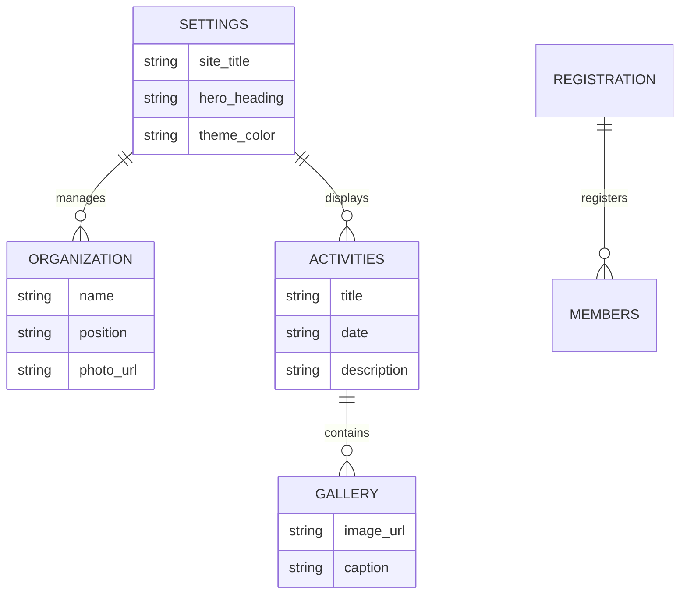

# Dokumentasi Sistem & Arsitektur - Saka Bhayangkara Jatinegara

Dokumen ini merangkum spesifikasi teknis, rancangan data, serta alur sistem untuk situs web resmi **Saka Bhayangkara Jatinegara** yang dilengkapi dengan panel administrasi berbasis *client-side*.

---

## 1. Arsitektur Sistem & Hash Routing (`#admin`)

Situs web ini menggunakan pendekatan *Single Page Application (SPA)* berbasis *Client-Side Rendering (CSR)*:
* **Tanpa Backend Terendam (*Serverless*):** Seluruh logika navigasi, interaksi antarmuka, dan penyimpanan sementara ditangani langsung oleh peramban pengguna menggunakan JavaScript (`localStorage`).
* **Sektor Keamanan Hash (`#admin`):** 
  1. Ketika pengguna menambahkan `#admin` pada akhir URL situs, skrip peramban secara otomatis mendeteksi perubahan *hash*.
  2. Sistem menampilkan modal autentikasi (meminta PIN).
  3. Jika PIN valid (`12345` sebagai default), panel kontrol (*dashboard*) terbuka.

---

## 2. Pemodelan Data & ERD (Entity-Relationship Diagram)

Meskipun menggunakan penyimpanan berbasis lokal atau integrasi Google Sheets, struktur data situs dibagi menjadi 5 entitas utama yang saling berelasi:

### Penjelasan Entitas:
1. **Settings**: Konfigurasi global situs (Judul, Teks Utama, Tema).
2. **Organization**: Data struktur kepengurusan Dewan Saka dan Pembina.
3. **Activities**: Jadwal serta informasi agenda kegiatan kepramukaan.
4. **Gallery**: Dokumentasi foto kegiatan.
5. **Registration**: Tautan formulir pendaftaran anggota baru via Google Form.

---

## 3. Fitur Utama & Keamanan
* **Autentikasi Sederhana:** Melindungi panel admin dari perubahan data ilegal oleh pengunjung umum.
* **Penyimpanan Lokal (`localStorage`):** Memungkinkan perubahan teks dan pengaturan langsung tersimpan di peramban tanpa perlu database eksternal yang kompleks.
* **Desain Responsif (Tailwind CSS):** Tampilan modern, adaptif di berbagai ukuran layar (ponsel, tablet, desktop).